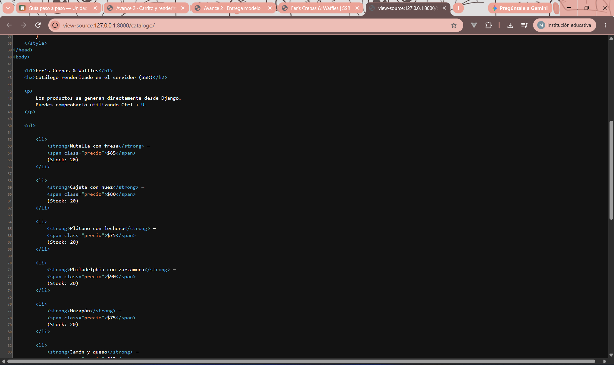
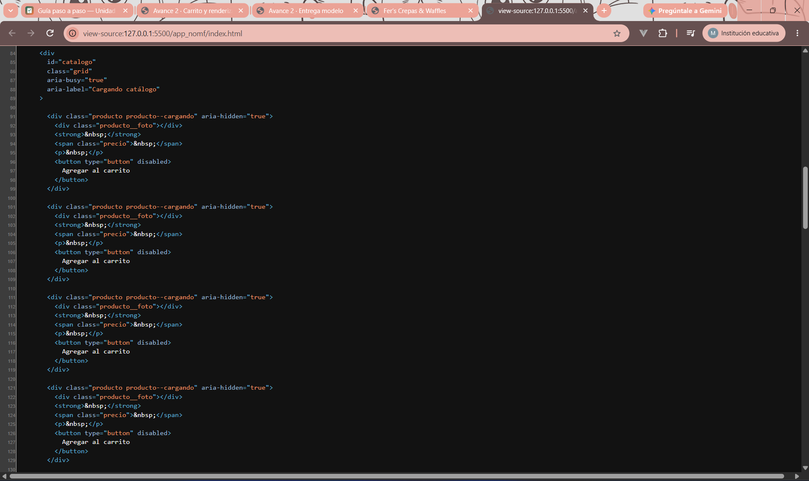
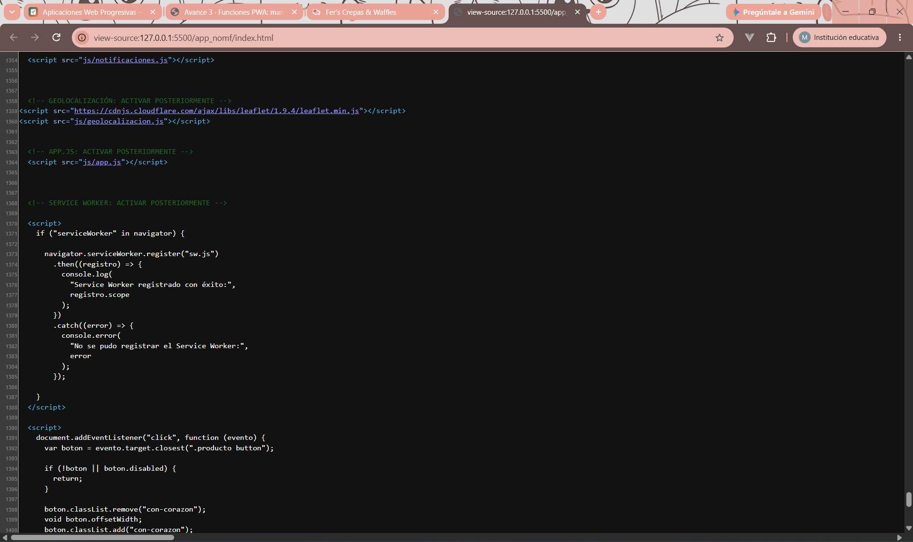
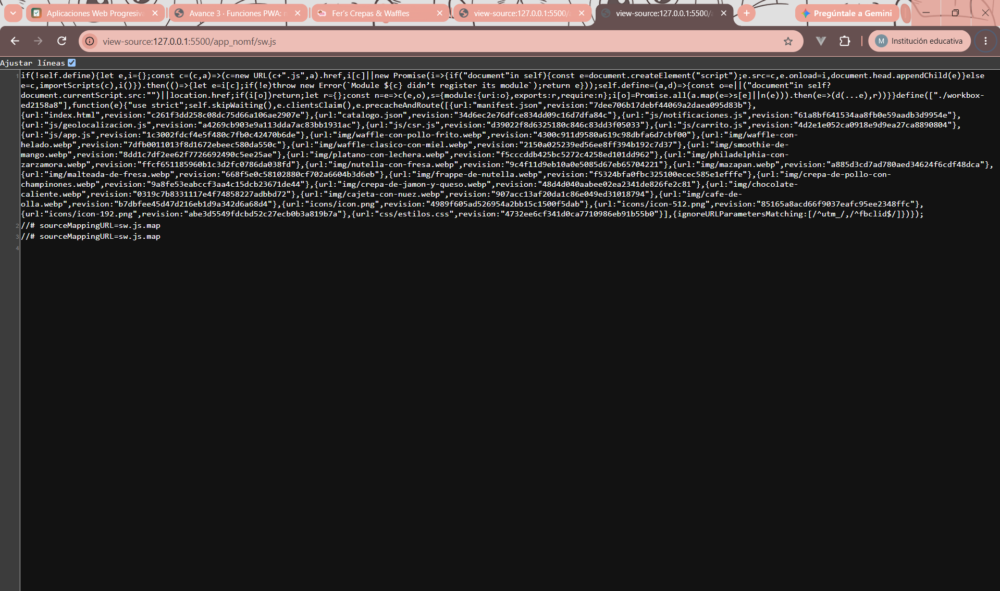
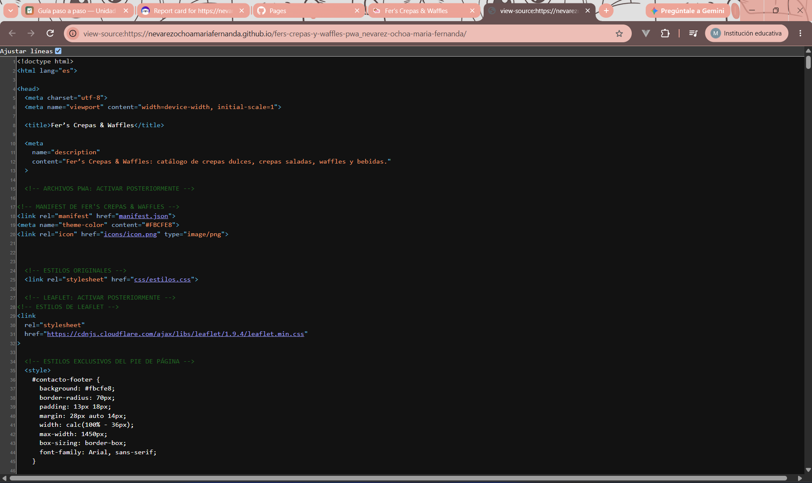
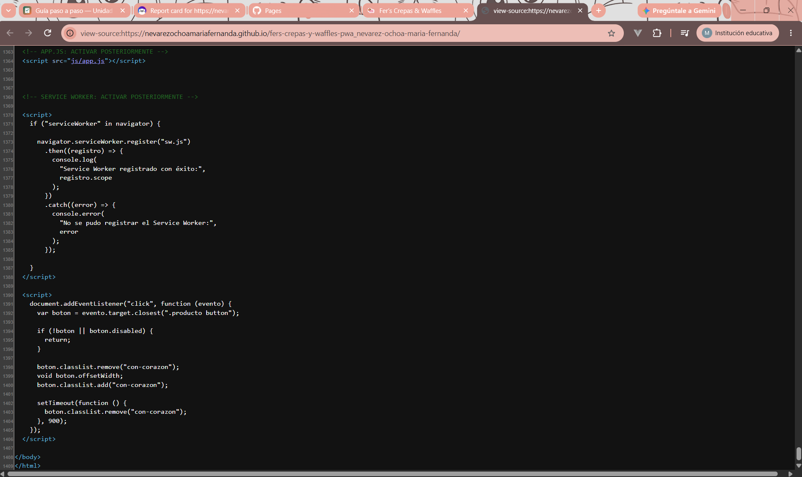
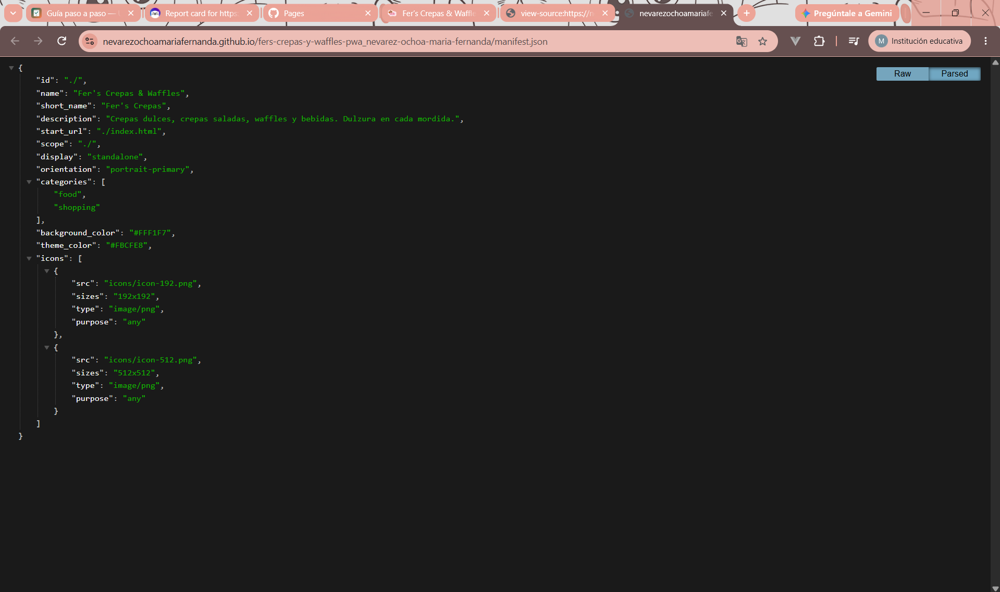

# Fer’s Crepas & Waffles — PWA de ventas

| Dato                    | Valor |
|-------------------------|-------|
| **Alumno**              | NEVAREZ OCHOA MARIA FERNANDA |
| **Grupo**               | ING10-1 |
| **Negocio · giro**      | Fer’s Crepas & Waffles · Crepería y waffles |
| **URL del repositorio** | https://github.com/nevarezochoamariafernanda/fers-crepas-y-waffles-pwa_nevarez-ochoa-maria-fernanda.git |
| **URL de GitHub Pages** | https://nevarezochoamariafernanda.github.io/fers-crepas-y-waffles-pwa_nevarez-ochoa-maria-fernanda/ |

## Historial de avances

| Avance | Hash del commit entregado |   Fecha    |
|--------|---------------------------|------------|
|    1   | eb9b41e                   | 11/10/2026 |
|    2   | cb26bb3                   | 18/10/2026 |
|    3   | 6f196d8                   | 25/10/2026 |
|    4   | (se escribe en el reporte PDF) | 01/11/2026 |

## Comparación SSR vs CSR

### SSR (Django): los productos llegan escritos en el HTML

### CSR (JavaScript): el div del catálogo llega vacío

## Funciones PWA (avance 3)

### index.html: manifest y registro del Service Worker activos

### sw.js: Workbox precachea el catálogo y las fotos

## Versión publicada (avance 4)

Código fuente publicado en GitHub Pages

Página principal (index.html):

Registro del Service Worker:

Manifest publicado:

Página publicada en mi teléfono:

## Instalación de la PWA en dispositivo móvil

La aplicación Fer’s Crepas & Waffles fue instalada y ejecutada correctamente en un dispositivo Samsung S25 Ultra mediante Google Chrome, utilizando la opción «Instalar aplicación».

## Auditorías Lighthouse

Se realizaron pruebas de rendimiento, accesibilidad, buenas prácticas y SEO en las versiones móvil y escritorio.

Reporte móvil: [Ver auditoría Lighthouse móvil](docs/lighthouse-movil.html)

Reporte escritorio: [Ver auditoría Lighthouse escritorio](docs/lighthouse-escritorio.html)

## Guía de instalación y uso

## 1. Abrir la aplicación

Para acceder a Fer’s Crepas & Waffles desde un dispositivo móvil o computadora, se deben seguir estos pasos:

1. Abrir un navegador web compatible. Se recomienda utilizar Google Chrome en Android y Safari en iPhone.
2. Escribir o copiar la siguiente dirección en la barra de navegación:

   https://nevarezoachomariafernanda.github.io/fers-crepas-y-waffles-pwa_nevarez-ochoa-maria-fernanda/

3. Presionar «Ir» o «Buscar» para ingresar al sitio.
4. Esperar a que la página termine de cargar.
5. Verificar que aparezca la página principal de Fer’s Crepas & Waffles, con su logotipo, catálogo de productos e información del negocio.

La aplicación está publicada mediante GitHub Pages, por lo que puede consultarse directamente desde el navegador sin instalar programas adicionales.

## 2. Instalar la aplicación

Fer’s Crepas & Waffles es una Aplicación Web Progresiva (PWA), por lo que puede instalarse en dispositivos móviles y agregarse a la pantalla de inicio para acceder a ella de manera más sencilla.

### Instalación en Android

1. Abrir Google Chrome desde el dispositivo Android.
2. Ingresar a la dirección de Fer’s Crepas & Waffles.
3. Esperar a que la página cargue completamente.
4. Presionar el menú de los tres puntos (⋮), ubicado en la esquina superior derecha.
5. Buscar y seleccionar la opción «Instalar aplicación». Si aparece «Agregar a pantalla principal», también puede utilizarse.
6. Cuando aparezca el mensaje de confirmación, seleccionar «Instalar».
7. Esperar a que finalice la instalación.
8. Regresar a la pantalla principal del dispositivo.
9. Buscar el icono de Fer’s Crepas & Waffles y presionarlo para abrir la aplicación.

### Instalación en iPhone (iOS)

1. Abrir Safari desde el dispositivo iPhone.
2. Ingresar a la dirección de Fer’s Crepas & Waffles.
3. Esperar a que la página cargue completamente.
4. Presionar el botón «Compartir», identificado con el símbolo de un cuadro y una flecha hacia arriba.
5. Deslizar las opciones del menú hasta encontrar «Agregar a pantalla de inicio».
6. Seleccionar dicha opción.
7. Verificar que aparezca el nombre Fer’s Crepas & Waffles.
8. Presionar «Agregar», ubicado en la esquina superior derecha.
9. Regresar a la pantalla de inicio del dispositivo.
10. Localizar el icono de la aplicación y presionarlo para abrirla.

**Nota:** En iPhone se recomienda realizar la instalación desde Safari. La disponibilidad de las opciones puede variar según la versión del sistema operativo y del navegador.

## 3. Utilizar la aplicación

Una vez instalada, Fer’s Crepas & Waffles puede abrirse directamente desde el icono que aparece en la pantalla de inicio del dispositivo.

Al ingresar, el usuario puede realizar las siguientes acciones:

1. **Consultar el catálogo:** visualizar los productos disponibles, sus imágenes, nombres, descripciones y precios.
2. **Filtrar productos:** utilizar las opciones de categorías para encontrar más fácilmente los productos que desea consultar.
3. **Agregar productos al carrito:** seleccionar el producto de interés y presionar el botón correspondiente para agregarlo al carrito de compras.
4. **Modificar cantidades:** aumentar o disminuir la cantidad de productos seleccionados mediante los controles del carrito.
5. **Consultar el carrito:** revisar los productos agregados, sus cantidades, subtotales y el total de la compra.
6. **Consultar información del negocio:** acceder a la información de Fer’s Crepas & Waffles, incluyendo su ubicación y los apartados disponibles en la aplicación.
7. **Utilizar las funciones adicionales:** acceder a las opciones de notificaciones y geolocalización cuando estén disponibles y se otorguen los permisos correspondientes.

El carrito permite mantener los productos seleccionados mediante el almacenamiento local del navegador, utilizando LocalStorage.

## 4. Funcionamiento sin conexión

La aplicación cuenta con un Service Worker generado mediante Workbox, encargado de almacenar previamente los recursos necesarios para facilitar el acceso a la aplicación cuando no se dispone de conexión a internet.

Para comprobar su funcionamiento sin conexión, se pueden seguir estos pasos:

1. Abrir Fer’s Crepas & Waffles mientras el dispositivo cuenta con conexión a internet.
2. Esperar a que carguen el catálogo, las imágenes y los demás recursos disponibles.
3. Cerrar o dejar en segundo plano la aplicación.
4. Desactivar la conexión Wi-Fi y los datos móviles del dispositivo.
5. Volver a abrir la aplicación.
6. Consultar los recursos que se hayan almacenado previamente en la caché.

Gracias al almacenamiento de recursos mediante Workbox, algunas partes de la aplicación pueden seguir consultándose sin conexión, siempre que hayan sido almacenadas previamente.

Además, la aplicación cuenta con una funcionalidad de sincronización simulada del carrito. Cuando se agregan productos sin conexión, estos pueden conservarse localmente y, al recuperar la conexión, se muestra un aviso indicando que la sincronización se realizó correctamente.

**Importante:** Las funciones que necesitan servicios externos o conexión a internet, como la carga de información nueva, los mapas y algunas operaciones de red, pueden no estar disponibles mientras el dispositivo permanezca sin conexión.

## 5. Actualizaciones

Fer’s Crepas & Waffles se encuentra publicada mediante GitHub Pages y utiliza un Service Worker para administrar los recursos almacenados en caché.

Cuando se realizan modificaciones en el proyecto, el proceso para publicar una nueva versión es el siguiente:

1. Realizar los cambios necesarios en los archivos del proyecto, como HTML, CSS, JavaScript, imágenes o archivos de configuración.
2. Guardar las modificaciones realizadas.
3. Actualizar el Service Worker cuando sea necesario, ejecutando Workbox para generar nuevamente el archivo `sw.js` y actualizar los recursos precargados.
4. Verificar que la aplicación funcione correctamente en el entorno local.
5. Agregar los archivos modificados al repositorio de Git.
6. Crear un commit que describa los cambios realizados.
7. Enviar los cambios al repositorio remoto de GitHub mediante `git push`.
8. Esperar a que GitHub Pages publique la nueva versión.
9. Abrir nuevamente la aplicación desde su dirección web para comprobar que los cambios estén disponibles.

Cuando se publica una actualización, el Service Worker puede detectar los nuevos recursos y preparar la versión actualizada de la aplicación. En algunos casos, será necesario cerrar y volver a abrir la aplicación o actualizar la página para visualizar los cambios.