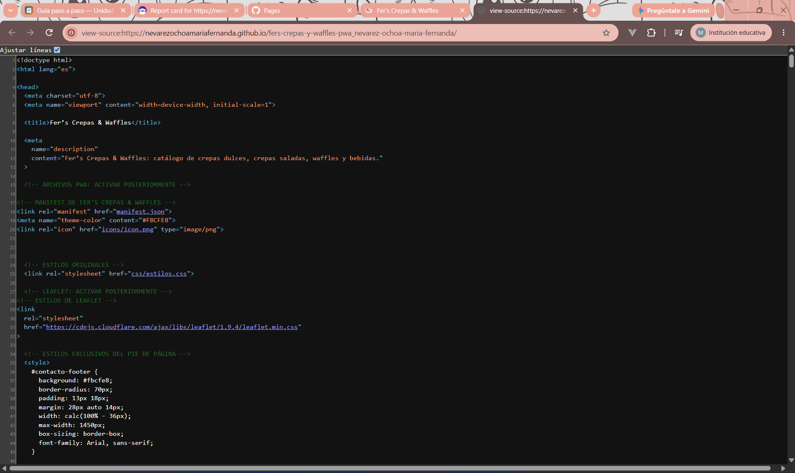
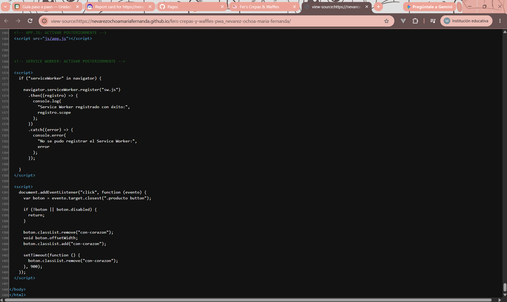
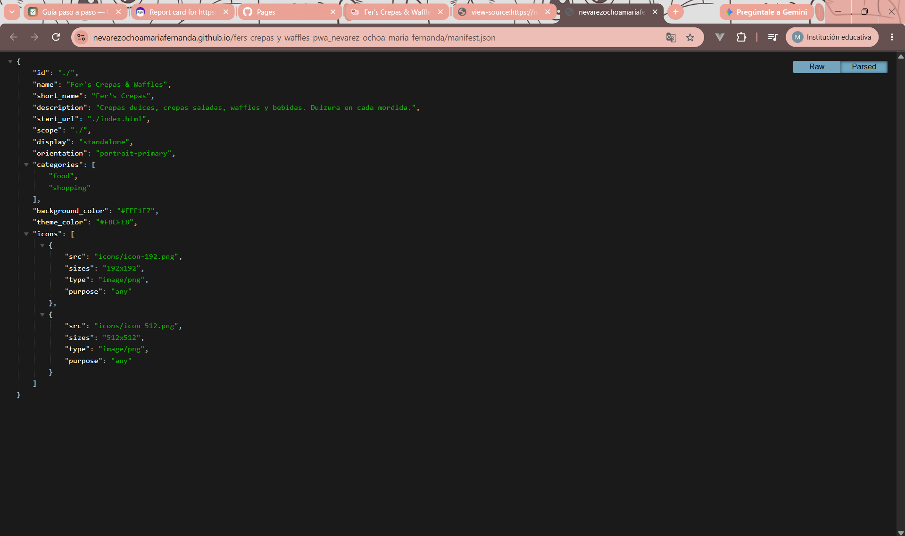
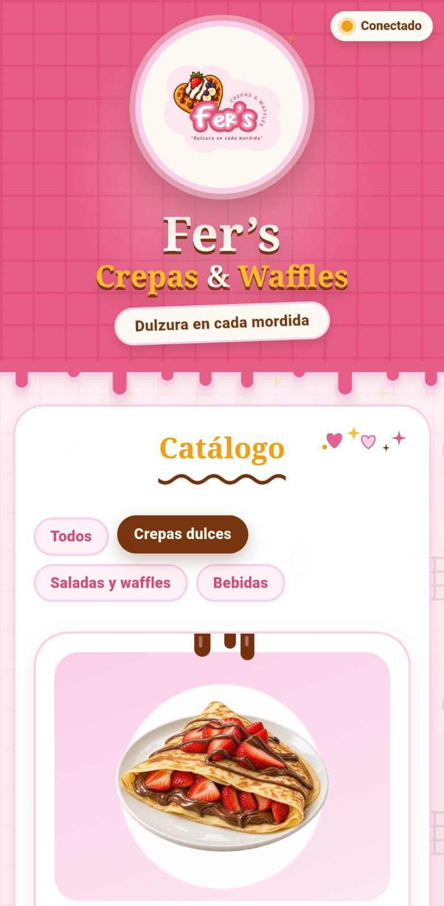

# Fer’s Crepas & Waffles — PWA de ventas

| Dato                    | Valor |
|-------------------------|-------|
| **Alumno**              | NEVAREZ OCHOA MARIA FERNANDA |
| **Grupo**               | ING10-1 |
| **Negocio · giro**      | Fer’s Crepas & Waffles · Crepería y waffles |
| **URL del repositorio** | https://github.com/nevarezochoamariafernanda/fers-crepas-y-waffles-pwa_nevarez-ochoa-maria-fernanda.git |
| **URL de GitHub Pages** | https://nevarezochoamariafernanda.github.io/fers-crepas-y-waffles-pwa_nevarez-ochoa-maria-fernanda/ |

## Historial de avances

| Avance | Hash del commit entregado |   Fecha    |
|--------|---------------------------|------------|
|    1   | eb9b41e                   | 11/10/2026 |
|    2   | cb26bb3                   | 18/10/2026 |
|    3   | 6f196d8                   | 25/10/2026 |
|    4   | (se escribe en el reporte PDF) | 01/11/2026 |

## Comparación SSR vs CSR

### SSR (Django): los productos llegan escritos en el HTML

### CSR (JavaScript): el div del catálogo llega vacío

## Funciones PWA (avance 3)

### index.html: manifest y registro del Service Worker activos

### sw.js: Workbox precachea el catálogo y las fotos

## Versión publicada (avance 4)

Código fuente publicado en GitHub Pages

Página principal (index.html):

Registro del Service Worker:

Manifest publicado:

Página publicada en mi teléfono:

## Instalación de la PWA en dispositivo móvil

La aplicación Fer’s Crepas & Waffles fue instalada y ejecutada correctamente en un dispositivo Samsung S25 Ultra mediante Google Chrome, utilizando la opción «Instalar aplicación».

## Auditorías Lighthouse

Se realizaron pruebas de rendimiento, accesibilidad, buenas prácticas y SEO en las versiones móvil y escritorio.

Reporte móvil: [Ver auditoría Lighthouse móvil](docs/lighthouse-movil.html)

Reporte escritorio: [Ver auditoría Lighthouse escritorio](docs/lighthouse-escritorio.html)

## Guía de instalación y uso

1. Abrir la aplicación

Ingresar desde Google Chrome a la siguiente dirección:

https://nevarezoachomariafernanda.github.io/fers-crepas-y-waffles-pwa_nevarez-ochoa-maria-fernanda/

2. Instalar la aplicación

En dispositivos Android, abrir el menú de Google Chrome y seleccionar la opción «Instalar». Confirmar la instalación y esperar a que aparezca el icono de la aplicación en el dispositivo.

3. Utilizar la aplicación

Una vez instalada, abrir Fer’s Crepas & Waffles desde su icono. Desde la aplicación se puede consultar el catálogo de productos, utilizar los filtros por categoría, agregar productos al carrito y consultar la información del negocio.

4. Funcionamiento sin conexión

La aplicación utiliza un Service Worker generado con Workbox para almacenar recursos y permitir el acceso a contenido disponible previamente, incluso cuando no existe conexión a internet.

5. Actualizaciones

La aplicación se publica mediante GitHub Pages. Cuando se realizan cambios en el proyecto, estos se envían al repositorio para actualizar la versión publicada.