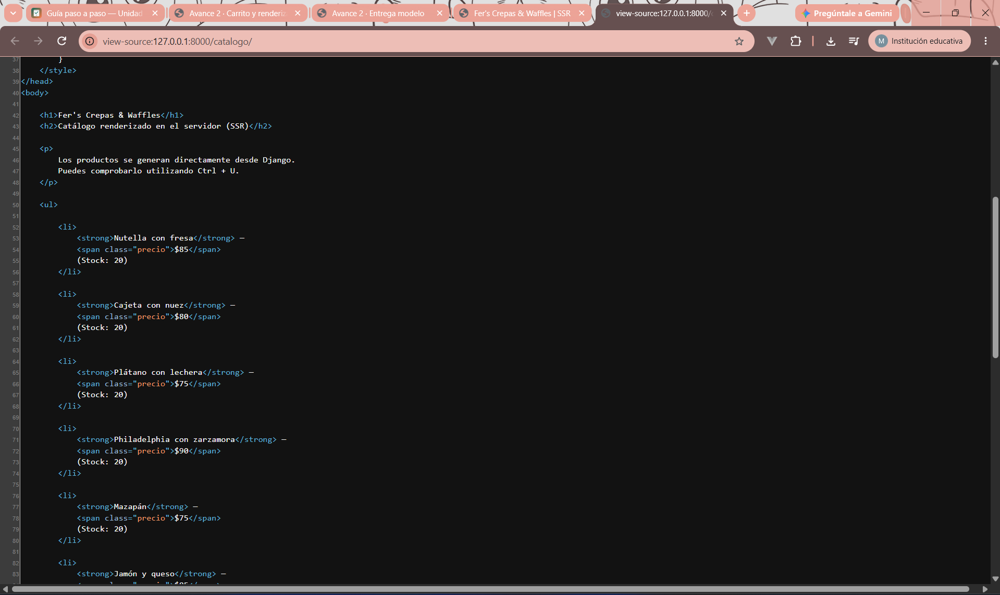
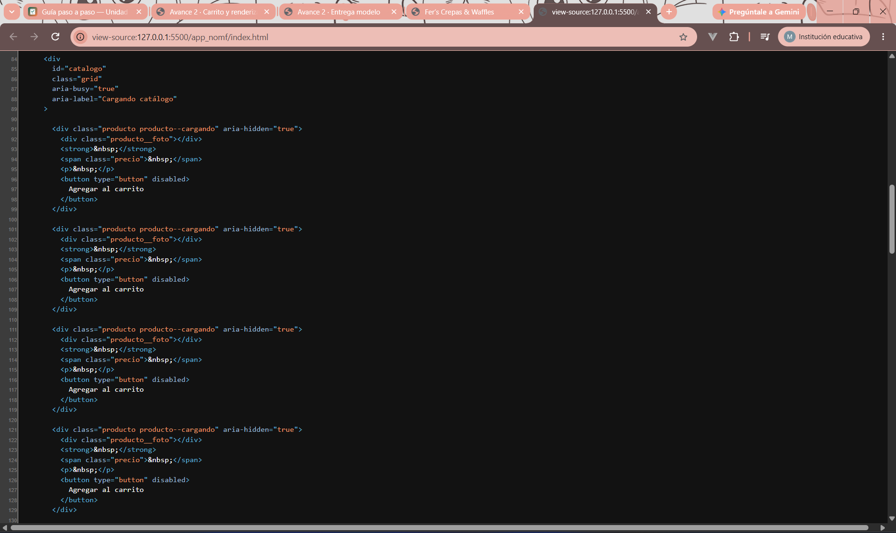
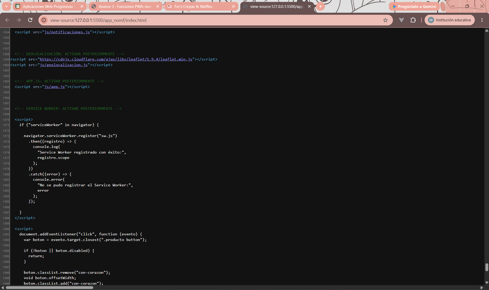
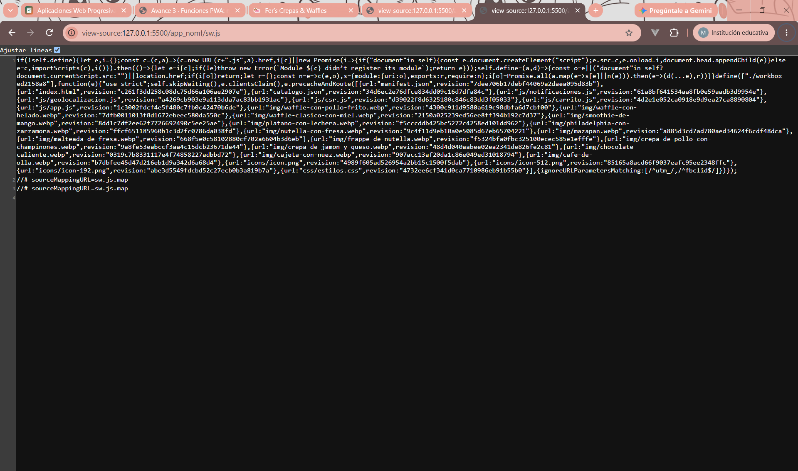

# Fer’s Crepas & Waffles — PWA de ventas

| Dato                    | Valor |
|-------------------------|-------|
| **Alumno**              | NEVAREZ OCHOA MARIA FERNANDA |
| **Grupo**               | ING10-1 |
| **Negocio · giro**      | Fer’s Crepas & Waffles · Crepería y waffles |
| **URL del repositorio** | https://github.com/nevarezochoamariafernanda/fers-crepas-y-waffles-pwa_nevarez-ochoa-maria-fernanda.git |
| **URL de GitHub Pages** | https://nevarezochoamariafernanda.github.io/fers-crepas-y-waffles-pwa_nevarez-ochoa-maria-fernanda/ |

## Historial de avances

| Avance | Hash del commit entregado |   Fecha    |
|--------|---------------------------|------------|
|    1   | eb9b41e                   | 11/10/2026 |
|    2   | cb26bb3                   | 18/10/2026 |
|    3   | (hash del avance 3)       | 25/10/2026 |
|    4   | (se escribe en el reporte PDF) | 01/11/2026 |

## Comparación SSR vs CSR

### SSR (Django): los productos llegan escritos en el HTML

### CSR (JavaScript): el div del catálogo llega vacío

## Funciones PWA (avance 3)

### index.html: manifest y registro del Service Worker activos

### sw.js: Workbox precachea el catálogo y las fotos
